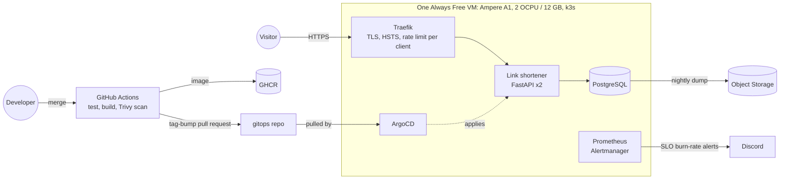

# oci-k8s-gitops-demo

A small service, run the way a production one should be: built, deployed,
observed and recovered through Git, on one free Oracle Cloud VM. This repo
holds the infrastructure (Terraform), the decisions (24 ADRs), the runbooks,
the test evidence and the issue tracker. Two sibling repos hold the
application and the Kubernetes manifests.

> **Status (2026-11-14):** live at
> **[demo.sandeeprn.in](https://demo.sandeeprn.in/)** on a single-node k3s
> cluster (one Always Free Ampere A1 VM). The landing page has a working short
> link; the API page is at `/docs`.
>
> Before that, the same service ran on a two-node OKE cluster (Oracle's managed
> Kubernetes), paid from trial credit. The multi-node tests below were done
> there. The OKE target served the site until 2026-11-12. It still exists with
> no public way in; its teardown is issue
> [#13](https://github.com/Sandeep-RN/oci-k8s-gitops-demo/issues/13) (due 2026-11-15).

## How it fits together



There is no load balancer. Visitors reach Traefik on the VM's public address,
and Traefik sees their real IP
([ADR 0022](docs/adr/0022-moving-the-demo-from-oke-to-k3s.md)). external-dns
keeps the DNS record and cert-manager the certificate; both run in the cluster.
The full picture, with the reasons, is in
**[docs/architecture.md](docs/architecture.md)**.

| Layer | What runs |
|---|---|
| Infrastructure | Terraform: network, one A1 VM, a backup bucket with write-only access, a tenancy quota policy and a budget |
| Cluster | k3s on Ubuntu 24.04 (arm64), ArgoCD app of apps, Sealed Secrets |
| Delivery | GitHub Actions: test, build for amd64 and arm64, Trivy scan, push. Then a tag-bump pull request merges itself and ArgoCD applies it |
| Edge | Traefik, cert-manager (Let's Encrypt, DNS-01), external-dns, HSTS, a rate limit per client, token-gated link creation |
| App | FastAPI link shortener, 2 replicas, PostgreSQL with nightly dumps to Object Storage |
| Observability | Prometheus, Alertmanager, Grafana; a 7-day SLO with burn-rate alerts to Discord; probes from inside and outside the cluster |

## Results, with the proof

| What was tested | Result | Proof |
|---|---|---|
| A change, from merge to running in the cluster | About 7 minutes, no manual step | [evidence](docs/evidence/oke-final-2026-11-10.md) |
| Rollout under live traffic | 514 requests, 0 failed | [evidence](docs/evidence/oke-final-2026-11-10.md), [video](https://youtu.be/_CFu4mpSBlg) |
| Node drain under live traffic | 1264 requests, 0 failed. The disruption budget refused the drain that would have taken the last pod | [evidence](docs/evidence/oke-final-2026-11-10.md), [video](https://youtu.be/ypoLkJUmsCI) |
| SLO alert on a real outage | A planned 5-minute database outage fired the critical alert to Discord 7.5 minutes after it began; it then resolved | [#53](https://github.com/Sandeep-RN/oci-k8s-gitops-demo/issues/53) |
| A whole cluster from Git | On a new k3s node, all 10 ArgoCD Applications were Synced and Healthy 3.5 minutes after the root Application was applied (after the key restore and the ArgoCD install) | [evidence](docs/evidence/k3s-bootstrap-2026-11-12.md) |
| Moving the live site to another cluster | The cutover was one pull request. The DNS record was absent for 25 seconds. All 34 rows restored | [evidence](docs/evidence/k3s-bootstrap-2026-11-12.md) |
| Backup and restore | Nightly dumps. Restore drilled on 2026-10-25 and done for real in the move on 2026-11-12 | [runbook](docs/runbooks/postgres-backup-restore.md) |
| Image scan gate | Blocked a real HIGH CVE before the image was pushed | [evidence](docs/evidence/oke-final-2026-11-10.md) |
| Rate limit per client | One client's burst of 600 requests got 282 answers of 429. Not run yet: the check that a second client still gets 200 during the burst | [#115](https://github.com/Sandeep-RN/oci-k8s-gitops-demo/issues/115) |
| Spend cap | A launch outside the allowed shapes was refused by the quota policy, before the account became Pay As You Go | [ADR 0021](docs/adr/0021-pay-as-you-go-with-guardrails.md), [#113](https://github.com/Sandeep-RN/oci-k8s-gitops-demo/issues/113) |

The drain, rollout and alert tests ran on the two-node OKE target, because one
node cannot show a drain. They ran at under one request a second: they show
that planned disruptions lose no requests, and they are not load tests. Each
evidence page ends with what the test does not show.

## Decisions I would defend

Every change of approach is an ADR. The index is
[docs/adr/README.md](docs/adr/README.md). Five to start with:

- **Readiness checks only the pod itself**
  ([ADR 0016](docs/adr/0016-readiness-checks-pod-local-state-only.md)). A
  readiness probe that checked the shared database took every pod out of the
  Service during a database outage. Requests were refused instead of answered,
  so the SLO never counted them. Found in a live test, then fixed.
- **CI never touches the cluster**
  ([ADR 0009](docs/adr/0009-ci-commits-image-tag-to-gitops-repo.md)). CI opens a
  pull request that changes the image tag in the gitops repo, and ArgoCD pulls
  it. No cluster credential exists outside the cluster, and Git is the audit
  log.
- **No load balancer on k3s**
  ([ADR 0022](docs/adr/0022-moving-the-demo-from-oke-to-k3s.md)). Measured with
  a packet capture: with `externalTrafficPolicy: Local`, Traefik sees real
  client addresses, so the rate limit is per client. The price is no redundancy
  at the edge, which a single node never had.
- **A quota is the cap; a budget is only an alarm**
  ([ADR 0021](docs/adr/0021-pay-as-you-go-with-guardrails.md)). An OCI budget
  sends an email, up to a day late. A quota policy refuses the create request.
  It was proven with a launch that had to fail.
- **Backups with a write-only identity**
  ([ADR 0017](docs/adr/0017-backup-auth-instance-principals-write-only.md)). The
  backup job can add a backup. It cannot read, overwrite or delete one. Expiry
  is a bucket lifecycle rule.

## Evidence

- **Test write-ups:** [docs/evidence/](docs/evidence/). Node drain
  ([2026-10-24](docs/evidence/oke-drain-2026-10-24.md)), drain, rollout and
  scan gate ([2026-11-08](docs/evidence/oke-final-2026-11-10.md)), k3s bootstrap
  and DNS switch ([2026-11-12](docs/evidence/k3s-bootstrap-2026-11-12.md)).
- **Videos** (silent screen recordings): [node drain, 2:00](https://youtu.be/ypoLkJUmsCI)
  and [rollout under traffic, 1:45](https://youtu.be/_CFu4mpSBlg).
- **Runbooks that were followed live, not only written:**
  [k3s bootstrap](docs/runbooks/k3s-bootstrap.md) (as run),
  [backup and restore](docs/runbooks/postgres-backup-restore.md),
  [Sealed Secrets keys](docs/runbooks/sealed-secrets.md),
  [the SLO alert](docs/runbooks/slo-redirect-availability.md),
  [the edge](docs/runbooks/edge.md),
  [cost guardrails](docs/runbooks/cost-guardrails.md).

## Known limits

- **One node, so no high availability.** A reboot, a k3s upgrade or a Traefik
  restart is an outage. Multi-node behaviour was shown on OKE, not here.
- **One PostgreSQL replica on the node's disk.** The recovery point is the last
  nightly backup, so up to 24 hours of data.
- **The clean rebuild is written but not yet run**
  ([#57](https://github.com/Sandeep-RN/oci-k8s-gitops-demo/issues/57)).
- **Nothing pages if the monitoring stack itself dies.** There is no dead man's
  switch, and the outside probe runs only every few hours.
- **Not built:** NetworkPolicies, log aggregation, autoscaling, a load test.

What comes next, and what would change at scale:
[docs/roadmap.md](docs/roadmap.md).

## The three repos

| Repo | Holds |
| --- | --- |
| **oci-k8s-gitops-demo** (this one) | Terraform for OCI, ADRs, glossary, runbooks, evidence, and the GitHub Issues tracker for all three repos |
| [oci-k8s-gitops-demo-app](https://github.com/Sandeep-RN/oci-k8s-gitops-demo-app) | FastAPI backend (it also serves the landing page), Dockerfile, GitHub Actions CI |
| [oci-k8s-gitops-demo-gitops](https://github.com/Sandeep-RN/oci-k8s-gitops-demo-gitops) | Kustomize manifests and ArgoCD Applications: the source of truth for the cluster |

## How this was built

I built this between 2026-10-20 and 2026-11-14 to practise running Kubernetes
the way I would want it run in production. Every change went through a pull
request (162 merged across the three repos, 16 of them automated image tag
bumps and 5 from Dependabot). Every change of approach is an
ADR. Every claim on this page links to a test that was run on a live cluster.

I used an AI coding assistant (Claude Code) throughout. It wrote much of the
YAML, Terraform and scripts, and first drafts of these docs. I made the
decisions, applied the infrastructure myself, ran or supervised every live
test, and reviewed and merged the pull requests (the image tag bumps merge
themselves once CI passes). A second model reviewed the first ADRs and found
real errors, which is why several say "revised after review". The `CLAUDE.md`
files and `docs/agents/` in these repos are the instructions I gave the
assistant.

## Repository layout

```
terraform/       OCI infrastructure, one root per lifecycle: k3s/, shared/, guardrails/, oke/
scripts/         state bootstrap, k3s tunnel and verify, public URL verify, OKE tunnel, A1 capacity retry
docs/architecture.md   How it is built and why
docs/adr/        Architecture decision records (0001 to 0024), with an index
docs/runbooks/   Access, k3s bootstrap, the edge, backups and restore, Sealed Secrets keys, the SLO alert, cost guardrails
docs/evidence/   Write-ups of tests run on the clusters
docs/roadmap.md  Known limits, next steps, what changes at scale
.github/         CI checks (Terraform fmt/validate/test, shellcheck), external probe (the slow outside check), gitleaks history scan, Dependabot
GLOSSARY.md      Project terms
PROJECT_BRIEF.md Facts, numbers and ready-made text for writing about this project elsewhere
```

## Cost

The design target is $0 a month on Always Free: one A1 VM, its boot volume,
Object Storage and the network all fit the free allowances. The account is
Pay As You Go, because that is what finally got the free VM its capacity
([ADR 0021](docs/adr/0021-pay-as-you-go-with-guardrails.md)). A tenancy quota
policy caps what can be created, and a budget watches the rest.

The OKE target cost about SGD 3.05 a day while it ran (SGD 45.69 from
2026-10-22 to 2026-11-06), paid from the trial credit. The $0 figure is
checked in Cost Analysis the day after the OKE teardown.

## Working here

Pull requests only, an issue first, gitleaks on every commit. See
[CONTRIBUTING.md](CONTRIBUTING.md).
