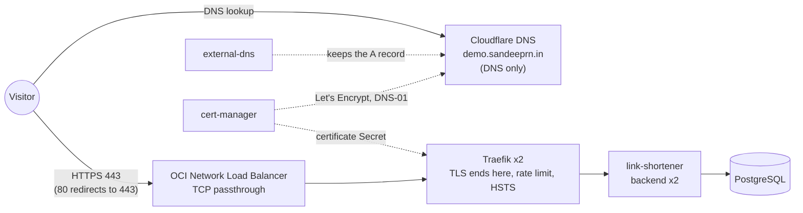

# oci-k8s-gitops-demo

Infrastructure, architecture decisions and runbooks for a public demo of
Kubernetes, Docker, CI/CD, GitOps and observability, running entirely on
**Oracle Cloud Always Free** (target cost: $0/month).

> **Status (2026-11-01):** live at **[demo.sandeeprn.in](https://demo.sandeeprn.in/docs)** (the API page; a landing page at `/` is #103) on a
> short-lived OKE target (ADR 0015, 0020): HTTPS with a Let's Encrypt
> certificate, the CI → GitOps → ArgoCD pipeline, the link shortener on
> PostgreSQL (creating a link needs a token; redirects are public), a redirect
> SLO with burn-rate alerts to Discord (proven with a live outage), an external
> probe, and nightly backups with a tested restore. The Always Free k3s node is
> blocked: the home region has had no A1 (or E2.1.Micro) capacity since
> 2026-10-22. OKE is torn down by 2026-11-15, so the URL is temporary. See
> **[docs/architecture.md](docs/architecture.md)** for what is built and
> verified, and [docs/evidence/](docs/evidence/) for test write-ups.

## The three repos

| Repo | Holds |
| --- | --- |
| **oci-k8s-gitops-demo** (this one) | Terraform for OCI, ADRs, glossary, runbooks, and the GitHub Issues tracker for all three repos |
| [oci-k8s-gitops-demo-app](https://github.com/Sandeep-RN/oci-k8s-gitops-demo-app) | FastAPI backend, static frontend, Dockerfiles, GitHub Actions CI |
| [oci-k8s-gitops-demo-gitops](https://github.com/Sandeep-RN/oci-k8s-gitops-demo-gitops) | Kustomize manifests and ArgoCD Applications (source of truth for the cluster) |

## The edge today (OKE)



Creating a link needs a named token (`Authorization: Bearer ...`); redirects,
lookups and health checks are public. Operate it with the
**[edge runbook](docs/runbooks/edge.md)**: debug or renew the certificate,
rotate a Cloudflare token, add or revoke a link-creation token. Check it from
outside with `scripts/verify-public-url.sh --production --hsts`.

## Target architecture (long-lived, planned)

```
Internet -> Cloudflare DNS (DNS only)
         -> OCI Network Load Balancer (TCP passthrough; DNS kept by external-dns)
         -> Traefik on a single-node k3s cluster (Ampere A1 VM, 2 OCPU / 12 GB)
         -> link-shortener app (FastAPI) + PostgreSQL StatefulSet
```

The edge components above carry over to k3s unchanged; only the cluster
underneath differs (blocked on A1 capacity).

- **Infra:** VCN, public subnet, Internet Gateway, NLB and one A1 VM, all in
  Terraform. State lives in a versioned Object Storage bucket (ADR 0003).
- **Cluster:** Ubuntu 24.04 aarch64, single-node k3s, cloud-init fixes the
  image's firewall rules (ADR 0001, 0002, 0012).
- **Delivery:** GitHub Actions builds, scans (Trivy) and pushes a multi-arch
  image, then opens a tag-bump PR in the gitops repo; ArgoCD syncs it (ADR 0009).
- **Edge and secrets:** Traefik Ingress, cert-manager with Cloudflare DNS-01,
  external-dns, token-gated link creation, Sealed Secrets (ADR 0004, 0005,
  0006, 0020). Built and live on OKE, while A1 capacity is unavailable.
- **Observability:** kube-prometheus-stack, a 7-day redirect SLO with
  multi-window burn-rate alerts to Discord, and an external probe (ADR 0008).

## Repository layout

```
terraform/       OCI infrastructure, one root per lifecycle: oke/, shared/, k3s/
scripts/         state bootstrap, OKE tunnel, A1 capacity watcher, public URL verify
docs/adr/        Architecture decision records (0001-0020)
docs/runbooks/   Access, alerts, backups and restore, Sealed Secrets keys, the edge (certificate, tokens)
docs/evidence/   Write-ups of tests run on the cluster (node drain)
.github/         external probe (slow outside check, ADR 0019), gitleaks history scan
GLOSSARY.md      Project terms
```

## Working here

- Every change goes through a pull request (ADR 0011).
- A change of approach needs a new ADR in `docs/adr/`.
- Install hooks once: `pip install pre-commit && pre-commit install`. They run
  gitleaks (with custom OCI rules in `.gitleaks.toml`), `terraform fmt` and
  `terraform validate`. CI scans the full history with gitleaks too, since
  `git commit --no-verify` skips hooks.
- Every task starts from an issue in its phase milestone; PRs close it with
  `Closes Sandeep-RN/oci-k8s-gitops-demo#N`.
- **This repo is public.** Never commit tfstate, real `*.tfvars`, OCI keys,
  kubeconfig, OCIDs, public IPs, passwords or tokens. Use `example.tfvars`
  with placeholders.

## Cost

The final demo stays inside Always Free. The $300 trial credit is only for
disposable experiments, and any non-free resource must be listed and deleted
before the trial ends (~2026-11-19). See ADR 0001.

Billed today: the OKE target only (two E5 worker nodes, about USD 2 a day,
SGD 6 spent by 2026-10-24). Its teardown checklist, including the
Kubernetes-created volumes and the Network Load Balancer that Terraform does
not track, and the rule to delete the Ingress before the cluster, is issue #13.
