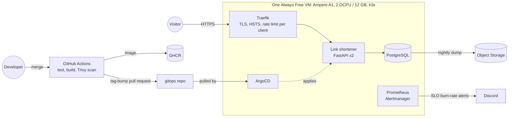

# oci-k8s-gitops-demo

A small service, run the way a production one should be: built, deployed,
observed and recovered through Git, on one free Oracle Cloud VM. This repo
holds the infrastructure (Terraform), the decisions (25 ADRs), the runbooks,
the test evidence and the issue tracker. Two sibling repos hold the
application and the Kubernetes manifests, and a third holds a second
application, the on-call assistant.

> **Status (2026-11-23):** live at
> **[demo.sandeeprn.in](https://demo.sandeeprn.in/)** on a single-node k3s
> cluster (one Always Free Ampere A1 VM). The landing page has a working short
> link; the API page is at `/api/docs`. A second application, an on-call
> assistant, runs on the same node at
> **[ask.sandeeprn.in](https://ask.sandeeprn.in/)**
> ([below](#a-second-app-the-on-call-assistant)).
>
> Before that, the same service ran on a two-node OKE cluster (Oracle's managed
> Kubernetes), paid from trial credit. The multi-node tests below were done
> there. The OKE target served the site until 2026-11-12 and was destroyed on
> 2026-11-15 (issue [#13](https://github.com/Sandeep-RN/oci-k8s-gitops-demo/issues/13)).

## How it fits together



There is no load balancer. Visitors reach Traefik on the VM's public address,
and Traefik sees their real IP
([ADR 0022](docs/adr/0022-moving-the-demo-from-oke-to-k3s.md)). external-dns
keeps the DNS record and cert-manager the certificate; both run in the cluster.
The full picture, with the reasons, is in
**[docs/architecture.md](docs/architecture.md)**.

| Layer | What runs |
|---|---|
| Infrastructure | Terraform: network, one A1 VM, a backup bucket with write-only access, a tenancy quota policy and a budget |
| Cluster | k3s on Ubuntu 24.04 (arm64), ArgoCD app of apps, Sealed Secrets |
| Delivery | GitHub Actions: test, build for amd64 and arm64, Trivy scan, push. Then a tag-bump pull request merges itself and ArgoCD applies it |
| Edge | Traefik, cert-manager (Let's Encrypt, DNS-01), external-dns, HSTS, a rate limit per client, token-gated link creation |
| App | FastAPI link shortener, 2 replicas, PostgreSQL with nightly dumps to Object Storage |
| Observability | Prometheus, Alertmanager, Grafana; a 7-day SLO with burn-rate alerts to Discord; probes from inside and outside the cluster; alerts for certificate expiry, Traefik 5xx and node disk, each with a runbook (unit-tested, none has fired yet) |

## Results, with the proof

| What was tested | Result | Proof |
|---|---|---|
| A change, from merge to running in the cluster | About 7 minutes, no manual step | [evidence](docs/evidence/oke-final-2026-11-10.md) |
| Rollout under live traffic | 514 requests, 0 failed | [evidence](docs/evidence/oke-final-2026-11-10.md), [video](https://youtu.be/_CFu4mpSBlg) |
| Node drain under live traffic | 1264 requests, 0 failed. The disruption budget refused the drain that would have taken the last pod | [evidence](docs/evidence/oke-final-2026-11-10.md), [video](https://youtu.be/ypoLkJUmsCI) |
| SLO alert on a real outage | A planned 5-minute database outage fired the critical alert to Discord 7.5 minutes after it began; it then resolved | [#53](https://github.com/Sandeep-RN/oci-k8s-gitops-demo/issues/53) |
| A whole cluster from Git | On a new k3s node, all 10 ArgoCD Applications were Synced and Healthy 3.5 minutes after the root Application was applied (after the key restore and the ArgoCD install) | [evidence](docs/evidence/k3s-bootstrap-2026-11-12.md) |
| Moving the live site to another cluster | The cutover was one pull request. The DNS record was absent for 25 seconds. All 34 rows restored | [evidence](docs/evidence/k3s-bootstrap-2026-11-12.md) |
| Deleting the cluster and rebuilding it on the same VM | 20 min 36 s from the end of the uninstall to the data restored: 10 Applications healthy after 17 min 57 s, all 38 rows back, `terraform plan` empty before and after. Includes the time a person needed; the VM itself was not rebuilt | [evidence](docs/evidence/rebuild-proof-2026-11-21.md) |
| Backup and restore | Nightly dumps. Restore drilled on 2026-10-25 and done for real in the move on 2026-11-12 | [runbook](docs/runbooks/postgres-backup-restore.md) |
| Sealed Secrets key renewal | The controller made its second key on 2026-11-23 at 07:57 UTC, exactly 30 days after the first key's certificate started. Both keys were backed up offline the same day, with their fingerprints checked against the cluster, before the repository's certificate was refreshed. The 13 secrets sealed earlier kept decrypting | [runbook](docs/runbooks/sealed-secrets.md), [#216](https://github.com/Sandeep-RN/oci-k8s-gitops-demo/issues/216) |
| Image scan gate | Blocked a real HIGH CVE before the image was pushed | [evidence](docs/evidence/oke-final-2026-11-10.md) |
| Rate limit per client | One client's burst of 600 requests got 282 answers of 429. While a laptop got 1410 x 429 over a 60 second flood, a phone on mobile data was served normally on every reload | [#115](https://github.com/Sandeep-RN/oci-k8s-gitops-demo/issues/115), [evidence](docs/evidence/k3s-live-checks-2026-11-21.md) |
| Spend cap | A launch outside the allowed shapes was refused by the quota policy, before the account became Pay As You Go | [ADR 0021](docs/adr/0021-pay-as-you-go-with-guardrails.md), [#113](https://github.com/Sandeep-RN/oci-k8s-gitops-demo/issues/113) |

The drain, rollout and alert tests ran on the two-node OKE target, because one
node cannot show a drain. They ran at under one request a second: they show
that planned disruptions lose no requests, and they are not load tests. Each
evidence page ends with what the test does not show.

## A second app: the on-call assistant

The same node also runs a small AI app. It answers on-call questions from this
project's own documents, with citations, or says it does not know. It is a
separate repo, [oncall-assistant](https://github.com/Sandeep-RN/oncall-assistant), live at
[ask.sandeeprn.in](https://ask.sandeeprn.in/). The platform side is here:
[ADR 0025](docs/adr/0025-second-application-on-the-node-inside-a-hard-cap.md) gives it its own namespace and a hard cap
of 1 GiB of memory and 1 CPU for everything in it, at a lower priority than the
link shortener. Its manifests are in the gitops repo, and ArgoCD applies them
like everything else.

| What was tested | Result | Proof |
|---|---|---|
| First full index of the documents | 7 min 4 s for 286 passages from 49 documents; the database is 9 MB. The index Job peaked at 271 MiB inside its 384 MiB limit, with no restart and no out-of-memory kill | [#196](https://github.com/Sandeep-RN/oci-k8s-gitops-demo/issues/196#issuecomment-7076495326) |
| The cap refuses what does not fit | With 960 MiB of memory limits in use, a 128 MiB pod was refused by the quota and a 64 MiB pod was accepted (a dry run: nothing was created) | [#196](https://github.com/Sandeep-RN/oci-k8s-gitops-demo/issues/196#issuecomment-7076495326) |
| First scheduled nightly index | 20 s: 1 changed document, 7 passages embedded. Peak 254 MiB of 384 MiB, no restart, no out-of-memory kill | [#196](https://github.com/Sandeep-RN/oci-k8s-gitops-demo/issues/196#issuecomment-7089851678) |
| Rate limit and body cap on `/ask` | The first live test showed the limit was not applied (Traefik ranks routes by rule length); fixed with an explicit priority and a CI rule. Then five quick calls gave 422, 422, 422, 429, 429, and a 6 KB body gave 413 | [#195](https://github.com/Sandeep-RN/oci-k8s-gitops-demo/issues/195#issuecomment-7076302508) |
| Does retrieval find the right passage? | In 25 of the 28 answerable questions of a 39-question set, a passage from the right document and section is in the top 5 (89%). The set was drafted by the assistant and is easier than real on-call questions, so the score is flattering | [oncall-assistant README](https://github.com/Sandeep-RN/oncall-assistant#readme) |

Not done yet: the quality of the answers and the assistant's own SLO are not
measured (milestone M2), and it has no live-state tools (M3). The numbers above
are about the platform holding it, not about how good its answers are.

## Decisions I would defend

Every change of approach is an ADR. The index is
[docs/adr/README.md](docs/adr/README.md). Five to start with:

- **Readiness checks only the pod itself**
  ([ADR 0016](docs/adr/0016-readiness-checks-pod-local-state-only.md)). A
  readiness probe that checked the shared database took every pod out of the
  Service during a database outage. Requests were refused instead of answered,
  so the SLO never counted them. Found in a live test, then fixed.
- **CI never touches the cluster**
  ([ADR 0009](docs/adr/0009-ci-commits-image-tag-to-gitops-repo.md)). CI opens a
  pull request that changes the image tag in the gitops repo, and ArgoCD pulls
  it. No cluster credential exists outside the cluster, and Git is the audit
  log.
- **No load balancer on k3s**
  ([ADR 0022](docs/adr/0022-moving-the-demo-from-oke-to-k3s.md)). Measured with
  a packet capture: with `externalTrafficPolicy: Local`, Traefik sees real
  client addresses, so the rate limit is per client. The price is no redundancy
  at the edge, which a single node never had.
- **A quota is the cap; a budget is only an alarm**
  ([ADR 0021](docs/adr/0021-pay-as-you-go-with-guardrails.md)). An OCI budget
  sends an email, up to a day late. A quota policy refuses the create request.
  It was proven with a launch that had to fail.
- **Backups with a write-only identity**
  ([ADR 0017](docs/adr/0017-backup-auth-instance-principals-write-only.md)). The
  backup job can add a backup. It cannot read, overwrite or delete one. Expiry
  is a bucket lifecycle rule.

## Evidence

- **Test write-ups:** [docs/evidence/](docs/evidence/). Node drain
  ([2026-10-24](docs/evidence/oke-drain-2026-10-24.md)), drain, rollout and
  scan gate ([2026-11-08](docs/evidence/oke-final-2026-11-10.md)), k3s bootstrap
  and DNS switch ([2026-11-12](docs/evidence/k3s-bootstrap-2026-11-12.md)),
  cluster rebuild on the same VM
  ([2026-11-21](docs/evidence/rebuild-proof-2026-11-21.md)).
- **Videos** (silent screen recordings): [node drain, 2:00](https://youtu.be/ypoLkJUmsCI),
  [rollout under traffic, 1:45](https://youtu.be/_CFu4mpSBlg) and
  [OKE live tour (app, ArgoCD, Grafana SLO, alerts), 9:36](https://youtu.be/jkP26YOaopc).
- **Runbooks that were followed live, not only written:**
  [k3s bootstrap](docs/runbooks/k3s-bootstrap.md) (as run),
  [backup and restore](docs/runbooks/postgres-backup-restore.md),
  [Sealed Secrets keys](docs/runbooks/sealed-secrets.md),
  [the SLO alert](docs/runbooks/slo-redirect-availability.md),
  [the edge](docs/runbooks/edge.md),
  [cost guardrails](docs/runbooks/cost-guardrails.md).

## Known limits

- **One node, so no high availability.** A reboot, a k3s upgrade or a Traefik
  restart is an outage. Multi-node behaviour was shown on OKE, not here.
- **One PostgreSQL replica on the node's disk.** The recovery point is the last
  nightly backup, so up to 24 hours of data.
- **The cluster rebuild was run once, the VM rebuild was not.** The cluster was
  deleted and rebuilt on the same VM from Git, the key backup and the data
  backup in 20 min 36 s
  ([evidence](docs/evidence/rebuild-proof-2026-11-21.md),
  [#57](https://github.com/Sandeep-RN/oci-k8s-gitops-demo/issues/57)). A
  replaced VM would take the Terraform and cloud-init path, which is untested
  (`prevent_destroy`).
- **Nothing pages if the monitoring stack itself dies.** There is no dead man's
  switch, and the outside probe runs only every few hours.
- **The link shortener's `/api/docs` page is open to everyone.** It is a demo API page
  and is linked above on purpose, but it loads its Swagger UI script from a
  third-party CDN. The assistant's own API docs are switched off for that reason
  ([oncall-assistant#47](https://github.com/Sandeep-RN/oncall-assistant/issues/47)).
- **Not built:** NetworkPolicies, log aggregation, autoscaling, a load test.

What comes next, and what would change at scale:
[docs/roadmap.md](docs/roadmap.md).

## The four repos

| Repo | Holds |
| --- | --- |
| **oci-k8s-gitops-demo** (this one) | Terraform for OCI, ADRs, glossary, runbooks, evidence, and the GitHub Issues tracker for all three repos |
| [oci-k8s-gitops-demo-app](https://github.com/Sandeep-RN/oci-k8s-gitops-demo-app) | FastAPI backend (it also serves the landing page), Dockerfile, GitHub Actions CI |
| [oci-k8s-gitops-demo-gitops](https://github.com/Sandeep-RN/oci-k8s-gitops-demo-gitops) | Kustomize manifests and ArgoCD Applications: the source of truth for the cluster |
| [oncall-assistant](https://github.com/Sandeep-RN/oncall-assistant) | The on-call assistant: a retrieval app (FastAPI, PostgreSQL with pgvector) with its own tests, evals, CI and issue tracker. Its platform side (ADR 0025) is tracked here |

## How this was built

I built the platform between 2026-10-20 and 2026-11-14 to practise running
Kubernetes the way I would want it run in production, then kept testing and
adding to it (the cluster rebuild on 2026-11-20 and 21, the assistant from
2026-11-18). Every change went through a pull request: on 2026-11-23, 213
merged across the three platform repos (34 of them automated image tag bumps,
10 from Dependabot) and 21 more in the assistant's repo. Every change of
approach is an ADR. Every claim on this page links to a test that was run on a live cluster.

I used an AI coding assistant (Claude Code) throughout. It wrote much of the
YAML, Terraform and scripts, and first drafts of these docs. I made the
decisions, applied the infrastructure myself, ran or supervised every live
test, and reviewed and merged the pull requests (the image tag bumps merge
themselves once CI passes). A second model reviewed the first ADRs and found
real errors, which is why several say "revised after review". The `CLAUDE.md`
files and `docs/agents/` in these repos are the instructions I gave the
assistant.

## Repository layout

```
terraform/       OCI infrastructure, one root per lifecycle: k3s/, shared/, guardrails/
scripts/         state bootstrap, k3s tunnel and verify, public URL verify, A1 capacity retry (history)
docs/architecture.md   How it is built and why
docs/adr/        Architecture decision records (0001 to 0025), with an index
docs/runbooks/   Access, k3s bootstrap, the edge, backups and restore, Sealed Secrets keys, the SLO alert, cost guardrails, the k3s node
docs/evidence/   Write-ups of tests run on the clusters
docs/roadmap.md  Known limits, next steps, what changes at scale
.github/         CI checks (Terraform fmt/validate/test, shellcheck), external probe (the slow outside check), gitleaks history scan, Dependabot
GLOSSARY.md      Project terms
PROJECT_BRIEF.md Facts, numbers and ready-made text for writing about this project elsewhere
```

## Cost

The design target is $0 a month on Always Free: one A1 VM, its boot volume,
Object Storage and the network all fit the free allowances. The account is
Pay As You Go, because that is what finally got the free VM its capacity
([ADR 0021](docs/adr/0021-pay-as-you-go-with-guardrails.md)). A tenancy quota
policy caps what can be created, and a budget watches the rest.

The OKE target cost about SGD 3.05 a day while it ran (SGD 45.69 from
2026-10-22 to 2026-11-06, and SGD 44.96 in total for 2026-11-01 to
2026-11-15), paid from the trial credit. After the teardown,
Cost Analysis showed SGD 0.00 for every service on each day from 2026-11-16
to 2026-11-22 (and 0.00 so far on 2026-11-23); the last charges were on 2026-11-15, the teardown day
([#13](https://github.com/Sandeep-RN/oci-k8s-gitops-demo/issues/13)). The trial credit was due to end about
2026-11-19. The Console's subscription panel returns an error, so I cannot show
the final credit balance; this page claims no more than the daily figures.

## Working here

Pull requests only, an issue first, gitleaks on every commit. See
[CONTRIBUTING.md](CONTRIBUTING.md).
