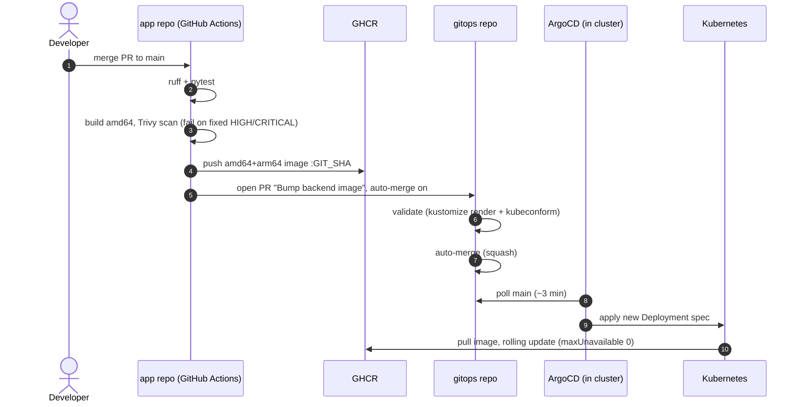
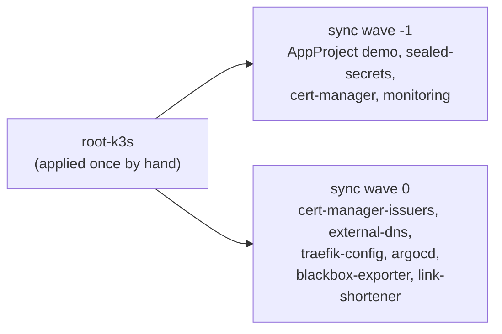
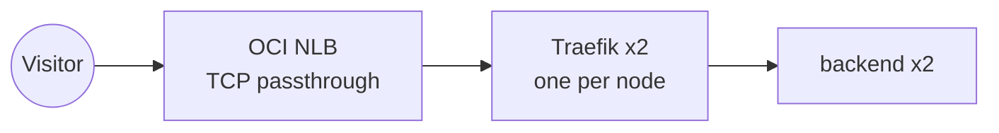
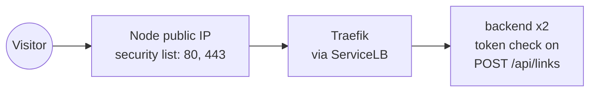
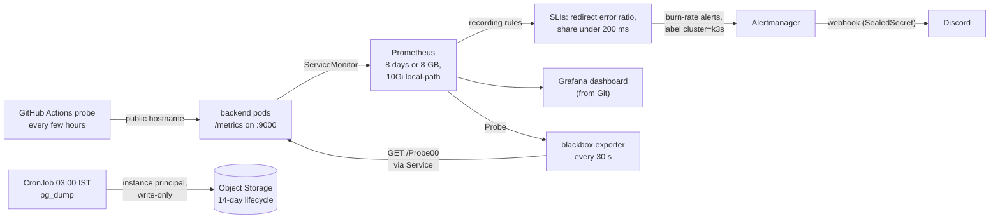
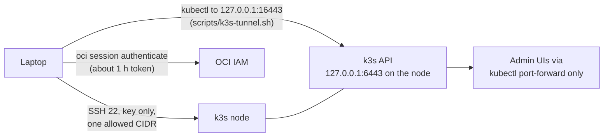

# Architecture

How the OCI Kubernetes GitOps demo is built, what runs today, and why it is
shaped this way. Decisions link to their ADRs in [`docs/adr/`](adr/).

> **As of 2026-11-13.** `https://demo.sandeeprn.in` runs on a single-node k3s
> cluster on one Ampere A1 VM sized inside Always Free, since the DNS switch on
> 2026-11-12. The OKE target served the site until 2026-11-12. It still exists
> with no public way in; its teardown is issue
> [#13](https://github.com/Sandeep-RN/oci-k8s-gitops-demo/issues/13) (due
> 2026-11-15). How the project got here:
> [section 11](#11-history-the-oke-target-and-the-move-to-k3s).

## 1. At a glance

| | Built and verified | Not built, or still open |
|---|---|---|
| **App** | FastAPI link shortener on PostgreSQL: 302 redirects, fail-fast 503s during a database outage, request metrics; landing page at `/` and API page at `/docs`, both served by the backend; non-root multi-arch image | No separate frontend (`frontend/` in the app repo is an empty placeholder) |
| **CI** | Lint, test (with real Postgres), Trivy scan, amd64+arm64 build, push to GHCR, auto-merging tag-bump PR; gitleaks full-history scan in all three repos | |
| **GitOps** | ArgoCD v3.5.6 app of apps `root-k3s`, self-managed, Kustomize base and overlays, Sealed Secrets, `validate` check (kubeconform, Helm render, promtool, amtool) | |
| **Cluster** | k3s v1.36.5+k3s1 on one A1 VM (2 OCPU / 12 GB), Terraform-managed, `prevent_destroy` | Rebuild proof on the same VM ([#57](https://github.com/Sandeep-RN/oci-k8s-gitops-demo/issues/57)); HPA; NetworkPolicies |
| **Edge** | No load balancer: node public IP, k3s's Traefik, real client IPs, per-client rate limit, cert-manager (Let's Encrypt production), external-dns, HSTS, token-gated link creation | |
| **Ops** | Prometheus, Grafana, Alertmanager; redirect SLO with burn-rate alerts to Discord; in-cluster and external probes; nightly backups with tested restores; quota cap and budget alerts; runbooks | k6 load job; log stack; dead man's switch for the monitoring stack |
| **OKE target** | Served the site until 2026-11-12; drain, PDB and rollout evidence captured | Teardown ([#13](https://github.com/Sandeep-RN/oci-k8s-gitops-demo/issues/13), due 2026-11-15), then the quota tightening |

## 2. Repositories

Three public repos, each with one job. Changes reach `main` only through pull
requests (ADR 0011).

| Repo | Holds | Changed by |
|---|---|---|
| [`oci-k8s-gitops-demo`](https://github.com/Sandeep-RN/oci-k8s-gitops-demo) | Terraform, scripts, ADRs, docs, issue tracker | Humans |
| [`oci-k8s-gitops-demo-app`](https://github.com/Sandeep-RN/oci-k8s-gitops-demo-app) | Backend code, Dockerfile, CI | Humans |
| [`oci-k8s-gitops-demo-gitops`](https://github.com/Sandeep-RN/oci-k8s-gitops-demo-gitops) | Kubernetes manifests, ArgoCD apps; the source of truth for every cluster | Humans, plus CI for image tags only |

## 3. Delivery pipeline

A merge in the app repo reaches the cluster with no manual step and no
credentials to the cluster outside it. The image is built for amd64 and arm64;
the arm64 image is what the A1 node runs.



Measured on the OKE target: on 2026-10-23, app commit `8ec9f5be` was running
on both pods after one merge. On 2026-11-08, a rollout under traffic took about
7 minutes from merge to live, with 514 requests and 0 failures
([evidence](evidence/oke-final-2026-11-10.md)).

Key properties:

- **Scan before push.** A vulnerable image never reaches the registry. On its
  first run, Trivy blocked three HIGH CVEs in Starlette, which were fixed by
  upgrading. On 2026-11-08 it blocked two fixable HIGH CVEs in `zlib1g` in the
  base image.
- **One tag per commit.** Images are tagged with the git SHA and a tag is never
  reused; `latest` is never used.
- **Every deploy is a merged PR** in the gitops repo, so the deploy history is
  the PR history (ADR 0009).
- **Least privilege.** The bump job has no `GITHUB_TOKEN` permissions. It uses a
  fine-grained token limited to the gitops repo (contents and pull requests).
  Third-party Actions are pinned by commit SHA.
- **A guarded `main`.** All three repos require a PR and linear history. The
  gitops repo also requires the `validate` check, and the app repo the `test`
  check. Auto-merge cannot bypass a broken manifest.

## 4. GitOps structure

```
oci-k8s-gitops-demo-gitops/
  apps/link-shortener/
    base/                  Deployment, Service, PDB, Postgres StatefulSet, backup CronJob,
                           ServiceMonitor, Probe, SLO rules, dashboard; image tag set by CI
    overlays/k3s/          Ingress, rate-limit and HSTS middlewares, local-path volume,
                           backup cluster name, sealed Postgres credentials and link tokens
    overlays/oke/          OKE differences; no Ingress since the DNS switch
  edge/                    cert-manager/ and external-dns/ values (values-k3s.yaml, values-oke.yaml);
                           traefik-k3s/ (HelmChartConfig for k3s's Traefik, sealed public IP,
                           ServiceMonitor); traefik/ (upstream chart values, OKE only)
  platform/                sealed-secrets controller; cert-manager-issuers and external-dns
                           with their sealed Cloudflare tokens
  monitoring/              kube-prometheus-stack/ (values.yaml, values-k3s.yaml, values-oke.yaml),
                           blackbox-exporter/, and k3s/ and oke/ for the Grafana and Discord SealedSecrets
  scripts/                 seal-cloudflare-token.sh, seal-link-tokens.sh, seal-traefik-public-ip.sh
  tests/prometheus/        promtool unit tests for the alert rules
  argocd/
    install/               upstream ArgoCD v3.5.6, pinned, via Kustomize
    clusters/k3s/          root.yaml (root-k3s), apps/, sealed-secrets-cert.pem
    clusters/oke/          the same for the OKE target
```



`root-k3s` creates 9 Applications and one AppProject. With the root, ArgoCD
shows 10 Applications. The `argocd` Application manages ArgoCD itself (prune
off, server-side apply); `link-shortener` uses the `demo` project and
`overlays/k3s`.

- **Bootstrap is three manual steps, in this order**
  ([runbook](runbooks/k3s-bootstrap.md)): restore the Sealed Secrets keys from
  the offline backup, then `kubectl apply --server-side -k argocd/install`, then
  `kubectl apply -f argocd/clusters/k3s/root.yaml`. The keys come first because
  a controller that starts without them makes a new key, and no sealed file in
  the repo would decrypt. After that, ArgoCD upgrades itself from Git and every
  change is a PR.
- **The `demo` AppProject** limits workloads to this repo and the
  `link-shortener` namespace. Platform apps that need cluster-scoped objects
  or `kube-system` use the `default` project.
- **Overlays carry only real environment differences.** On k3s: the Postgres
  volume on `local-path` (5Gi), `BACKUP_CLUSTER=k3s`, the per-client rate
  limit, and the landing page's example link. On OKE: `oci-bv` volumes, a strict
  one-pod-per-node spread, and a shared rate limit. k3s runs on the OKE sealing
  keys, so both overlays hold the same sealed files (ADR 0022).

## 5. The cluster: k3s on one Always Free node

| | |
|---|---|
| Node | One `VM.Standard.A1.Flex` VM, 2 OCPU / 12 GB, 50 GB boot volume, Ubuntu 24.04 aarch64 ([ADR 0001](adr/0001-single-node-k3s-on-always-free-a1.md), [ADR 0002](adr/0002-ubuntu-2404-aarch64-node-os.md)) |
| Kubernetes | k3s v1.36.5+k3s1, single server, state in SQLite (no etcd) |
| Ingress | k3s's bundled Traefik (chart 40.1.5, Traefik 3.7.13), configured from Git by a `HelmChartConfig` |
| Service exposure | k3s's ServiceLB binds Traefik's 80/443 on the node |
| Storage | k3s's `local-path` storage class: directories on the boot volume. Postgres 5Gi, Prometheus 10Gi |
| Workloads | backend x2, PostgreSQL x1, ArgoCD, Sealed Secrets, cert-manager, external-dns, kube-prometheus-stack, blackbox exporter |
| Running since | 2026-11-11 |

**First boot** (cloud-init,
[ADR 0012](adr/0012-node-firewall-and-cloud-init.md)) runs one script,
`/usr/local/sbin/bootstrap-node.sh`, which is safe to run again. It removes
the REJECT rules that Oracle's Ubuntu image ships in iptables (they block
80/443 and break pod networking), so the OCI security list is the only inbound
gate. It makes SSH key-only with no root login (ADR 0010), then installs the
pinned k3s version with Traefik and ServiceLB enabled. No secret is in the
instance metadata: the k3s token and kubeconfig are made on the node and stay
there. The legacy metadata endpoint (IMDS v1) is disabled.

**`prevent_destroy`.** A1 capacity is scarce, and an instance that is destroyed
may never come back (ADR 0001). Terraform also ignores changes to the image and
to the cloud-init template, so a new Oracle image or a template edit can never
plan a replacement. The rebuild proof
([#57](https://github.com/Sandeep-RN/oci-k8s-gitops-demo/issues/57)) keeps the
VM and rebuilds only the cluster on it
([ADR 0022](adr/0022-moving-the-demo-from-oke-to-k3s.md)).

**What one node cannot do.**

- No high availability. A node reboot or a Traefik restart is an outage.
- A drain cannot be shown. With one node the evicted pods have nowhere to go,
  so a drain blocks on the PDB. The multi-node proof was done on OKE
  ([section 11](#11-history-the-oke-target-and-the-move-to-k3s)).
- One Postgres replica on a node-local volume, with no failover. The nightly
  dump is the recovery path.
- `local-path` does not enforce volume sizes. The 50 GB boot volume is shared by
  the OS, images, Postgres and Prometheus, so Prometheus has a size cap of its
  own (section 7).

**How the capacity arrived.** From 2026-10-22 the home region (one
availability domain) reported no A1 capacity at 2/12, 1/6 or 1/4, and none for
E2.1.Micro either. Polling did not help. The
account was upgraded to Pay As You Go on 2026-11-11, after cost guardrails were
applied and proven ([ADR 0021](adr/0021-pay-as-you-go-with-guardrails.md)).
The A1 node was created the minute the upgrade took effect. The node still fits
the Always Free allowance.

## 6. Edge

How a visitor reaches `https://demo.sandeeprn.in` on k3s
([ADR 0022](adr/0022-moving-the-demo-from-oke-to-k3s.md)).

**Before (OKE, until 2026-11-12):**



**Today (k3s):**



**Why there is no load balancer:**

- **The node only knows its private IP.** OCI maps the public IP outside the
  VM, so ServiceLB reports the private address in the Service status.
- **`externalTrafficPolicy: Local` keeps client IPs.** A packet capture on the
  node (2026-11-11) showed the visitor's own address arriving. With `Local`,
  Traefik sees it; with k3s's default `Cluster`, every client looked like the
  pod network gateway. So the rate limit can count each client separately.
- **Traefik writes the public IP into the Ingress status** from a SealedSecret
  (`PUBLIC_IP`, sealed only because the repos are public and hold no IPs in
  plain text). The `node-external-ip` flag would do the same, but would break
  `Local`.
- **external-dns publishes that address** to Cloudflare. If the IP ever changed
  (only if the instance or its VNIC were replaced), it would be re-sealed and
  the record would follow.

**What keeps it working.** Controllers in the cluster read the one Ingress in
the gitops repo and act on Cloudflare and Traefik, each with its own Cloudflare
token:

| Piece | What it does | Why this way |
|---|---|---|
| **DNS** (Cloudflare) | `demo.sandeeprn.in` A record, DNS only (not proxied) | Cloudflare's proxy would end TLS at Cloudflare; here TLS ends at our own certificate. The blog's records in the same zone are untouched |
| **external-dns** | Creates the A record and a TXT owner record (owner id `oci-demo-k3s`) from the Ingress; `policy: sync` | It deletes only records it owns, so two clusters can never fight over one name. The private-range exclusion from OKE stays as a guard: a wrongly sealed private IP publishes nothing rather than a dead record |
| **Entry** | The node's ephemeral public IP; the security list allows TCP 80 and 443 | Costs nothing and has fewer moving parts than a load balancer. An ephemeral IP lives as long as the instance, which `prevent_destroy` protects |
| **Traefik** (1 pod, k3s's own) | Redirects HTTP to HTTPS (a GET gets 301, other methods 308), terminates TLS, applies the rate limit and HSTS, routes to the Service | The same standard Ingress object as on OKE. Dashboard off (ADR 0014); metrics only on a ClusterIP Service |
| **cert-manager** | Issues and renews the Let's Encrypt certificate by DNS-01 on Cloudflare; renews 30 days before expiry | DNS-01 needs no inbound port. The site has HTTPS with a production certificate since 2026-10-31; on k3s the certificate was issued on the first order (2026-11-12) |
| **Rate limit** | 20 requests a second per client, burst 40 | Per client, because Traefik sees real client IPs. A burst of 600 requests from one client got 282 x 429. **Not run:** the check that a second client still gets 200 during that burst |
| **HSTS** | `max-age=15552000` (180 days) on this host only | Every response re-sends it, so a browser keeps enforcing HTTPS for 180 days after its last visit. No `includeSubDomains`, no preload, so the blog is unaffected |
| **Token gate** | `POST /api/links` needs `Authorization: Bearer TOKEN`; redirects, lookups and health are public | A public shortener on a real domain is an open redirector and would put the domain on blocklists. Tokens are named and stored with the link (`created_by`), so one can be revoked alone |

**Secrets.** Four kinds, all SealedSecrets in the gitops repo: the
cert-manager Cloudflare token, the external-dns Cloudflare token (separate, so
a leak or rotation affects one and Cloudflare's audit log tells them apart),
the link-creation tokens, and the node's public IP. Sealing scripts in the
gitops repo: `seal-cloudflare-token.sh`, `seal-link-tokens.sh` and
`seal-traefik-public-ip.sh`, all sealing with the k3s cluster's certificate.

**Verified on k3s** (2026-11-12 and 2026-11-13,
[bootstrap runbook](runbooks/k3s-bootstrap.md) steps 4, 5 and 8): the Ingress
status holds the public IP; `curl --resolve` got a trusted Let's Encrypt chain
before DNS moved. After the switch, `scripts/verify-public-url.sh --production
--hsts` run without a token passed every check except link creation, which
needs one; the owner's run with a token passed 9 checks, 0 failed, 2 skipped.

**Known limits.** One Traefik pod and one node, so no redundancy at the edge.
Rate-limit buckets live in that pod's memory, so a second replica would
double the effective limit. HSTS cannot be withdrawn early. Not tested: whether a pod on
the node can reach the public hostname (hairpin), so probes avoid it. The
[edge runbook](runbooks/edge.md) (certificate, token rotation) was written on
OKE; the k3s checks are in the bootstrap runbook.

## 7. Observability and backups



- **SLO (ADR 0008):** over 7 days, 99.5% of redirects are not 5xx, and 95% of
  the rest finish under 200 ms. Alerts are multi-window burn rates (14.4x and
  6x page, 3x and 1x ticket), with a 20-request traffic floor. Rules are
  unit-tested with promtool in CI
  ([runbook](runbooks/slo-redirect-availability.md)).
- **Fast-burn alert proven live** (2026-10-25, on OKE): a planned 5-minute
  database outage began 13:07:11 IST; `RedirectErrorBudgetBurnFast` fired at
  13:14:39 and resolved by 13:20:57, and Discord got both messages. The client
  saw 450 requests: 341 x 302, 109 x 503, 0 unanswered.
- **Readiness stays pod-local (ADR 0016):** a database outage keeps pods in the
  Service answering fast 503s, so every failure is counted by the SLI.
- **Synthetic probe (ADR 0019):** the blackbox exporter requests an unknown
  short code on the backend Service every 30 s (a 404 after a Postgres lookup).
  That gives the SLO steady traffic in quiet periods, and an alert fires when
  the probe gets no answer at all, which the app's metrics cannot see.
- **External probe:** a scheduled GitHub Actions job in this repo follows a real
  short link through the public hostname. GitHub runs it only every few hours.
  Of 84 runs sampled up to 2026-11-13 10:50 UTC, none failed, including the
  runs after the DNS switch.
- **Sized for one node.** Prometheus keeps 8 days or 8 GB, whichever comes
  first, on a 10Gi `local-path` volume. k3s runs the control plane in one
  process and has no etcd, so the chart's scheduler, controller-manager,
  kube-proxy and etcd targets are off; the first three's metrics arrive
  through the API server's endpoint. Every alert carries the label
  `cluster=k3s`.
- **Backups (ADR 0007, 0017):** a nightly `pg_dump`, checked with
  `pg_restore --list`, then uploaded as
  `link-shortener/<cluster>/<timestamp>.pgc` with `--no-overwrite`. The upload
  uses the node's instance principal, which may only create and list objects
  in the bucket; read, overwrite and delete were verified to be denied (on
  OKE). `PostgresBackupMissing` alerts after 26 h without a success.
- **Restore drills** ([runbook](runbooks/postgres-backup-restore.md)):
  2026-10-25 on OKE into a scratch database (9 rows, identical); 2026-11-12
  OKE's last backup restored into k3s (34 rows, equal to the dump). A backup
  written from k3s on 2026-11-12 proved the node's write-only identity.

## 8. Access model



- **No public Kubernetes API (ADR 0010).** Port 6443 is never open in the
  security list. `scripts/k3s-tunnel.sh` copies the node's kubeconfig over SSH,
  points it at `127.0.0.1:16443`, writes it to `~/.kube/k3s.kubeconfig`
  (outside the repo, mode 600) and holds the SSH tunnel open.
- **SSH** is key-only, no root login, from one allowed CIDR.
  `scripts/k3s-verify.sh` checks that SSH accepts keys only and that 6443 and
  the kubelet port are not reachable ([k3s access runbook](runbooks/k3s-access.md)).
- **No long-lived cloud keys on disk.** Terraform and the CLI use OCI session
  tokens (`auth = "SecurityToken"`).
- **Admin UIs** (ArgoCD, Grafana, Prometheus, Alertmanager) are reachable
  only by port-forward, never exposed (ADR 0014).

The OKE target had a private API endpoint instead, reached through OCI Bastion
with `scripts/oke-tunnel.sh`: a throwaway SSH key and session (at most 3 h)
for one client address, deleted on Ctrl+C ([OKE access runbook](runbooks/access.md)).

## 9. Infrastructure as code

Four Terraform roots, each with its own state key, so an apply in one can never
touch another's resources.

| Root | Holds | Lifecycle |
|---|---|---|
| `terraform/k3s` | VCN, internet gateway, public subnet, security list (22 from one CIDR, 80/443, path-MTU ICMP), the A1 instance with cloud-init | Long-lived; `prevent_destroy` on the instance |
| `terraform/shared` | Backup bucket, 14-day lifecycle rule, dynamic group and write-only policy | Outlives any cluster; `prevent_destroy` on the bucket |
| `terraform/guardrails` | One tenancy quota policy and one monthly budget with three alert rules (ADR 0021) | Changes on its own schedule; tightened after [#13](https://github.com/Sandeep-RN/oci-k8s-gitops-demo/issues/13) |
| `terraform/oke` | The OKE target: VCN, gateways, subnets, Basic cluster, node pool, Bastion | Tagged `teardown_by=2026-11-15`; destroyed in [#13](https://github.com/Sandeep-RN/oci-k8s-gitops-demo/issues/13) |

Scripts in this repo:

| Script | Use |
|---|---|
| [`bootstrap-state.sh`](../scripts/bootstrap-state.sh) | One time: compartment and versioned state bucket (idempotent) |
| [`k3s-tunnel.sh`](../scripts/k3s-tunnel.sh) | kubectl access to the k3s API over SSH |
| [`k3s-verify.sh`](../scripts/k3s-verify.sh) | Nine checks: no drift, `prevent_destroy`, SSH key-only, API and kubelet closed, first boot finished, node Ready, k3s version, pod DNS and egress |
| [`verify-public-url.sh`](../scripts/verify-public-url.sh) | Checks the public URL from outside: DNS, redirect, certificate, HSTS, token gate, rate limit |
| [`a1-wait-and-apply.sh`](../scripts/a1-wait-and-apply.sh) | Polls for A1 capacity and applies `terraform/k3s` when it appears (written for the capacity shortage) |
| [`oke-tunnel.sh`](../scripts/oke-tunnel.sh) | kubectl access to the OKE target through OCI Bastion |

- **State:** the native `oci` backend, in a versioned Object Storage bucket,
  with locking (ADR 0003).
- **Who applies:** the owner, from a laptop, with a short-lived OCI session
  token. No CI job holds OCI credentials.
- **Re-runnable:** `terraform plan` shows no changes after an apply;
  `k3s-verify.sh` checks this for `terraform/k3s`.
- **Guardrails on commits:** `terraform fmt`, `terraform validate` and gitleaks
  (with custom OCI rules) run as pre-commit hooks; gitleaks also scans the full
  history in CI in all three repos, because `--no-verify` skips hooks.
- **Checks in CI, with no credentials:** the `checks` workflow runs `fmt`,
  `validate` and `terraform test` for every root on Terraform 1.12.0 (the
  minimum) and the latest release, with the lock file read-only; shellcheck
  on every script; and the offline test of the A1 retry script.

## 10. Security summary

| Area | Control |
|---|---|
| Secrets in Git | gitleaks with OCI rules and a public-IPv4 rule, as a pre-commit hook and as a full-history CI job in every repo. tfvars, state, backend.hcl and kubeconfig are git-ignored. Outputs holding OCIDs or IPs are marked sensitive. Only SealedSecrets may be committed, and CI rejects plain `Secret` manifests. Even the node's public IP is sealed |
| Change control | Every repo needs a PR and linear history on `main`; required checks `test` (app) and `validate` (gitops) |
| Supply chain | Actions pinned by SHA; checksum-verified tool downloads; Trivy gate before push; pinned versions of charts, ArgoCD, Sealed Secrets and k3s |
| Runtime | Non-root UID 10001, read-only root filesystem, all capabilities dropped, seccomp `RuntimeDefault`, no service-account token mounted |
| Database | The backend uses its own non-superuser role that owns only its table; the superuser is kept for the server, backups and the role-setup Job (ADR 0018) |
| Network | The k3s node has a public IP in a public subnet. Its security list allows 22 from one CIDR, 80/443 and path-MTU ICMP; nothing else. The API is reached by SSH tunnel only. The host firewall is open, so the security list is the single gate (ADR 0012) |
| Cloud auth | Short-lived session tokens; a dedicated compartment. In-cluster access to OCI is the node's identity with a write-only policy on one bucket (ADR 0017). The legacy instance metadata endpoint is disabled |
| Cost | One tenancy quota policy as the hard cap (compute zeroed except A1 2 OCPU / 12 GB; E5 and extra block storage allowed only until the OKE teardown) and one monthly budget (SGD 7) with three alert rules: actual spend above SGD 1, actual at 100%, forecast at 100% (ADR 0021). A budget only alerts, up to a day late |

## 11. History: the OKE target and the move to k3s

### The OKE target

A short-lived second deploy target paid by the trial credit (ADR 0015). It
was created on 2026-10-22, when no A1 capacity was available, and proved that
the same GitOps repo runs on a managed, multi-node cluster.

| Aspect | Choice |
|---|---|
| Cluster | OKE Basic (free control plane), Kubernetes v1.36.4 |
| Nodes | 2 x `VM.Standard.E5.Flex`, 1 OCPU / 8 GB, one per fault domain (the region has one availability domain) |
| API | Private endpoint only, through OCI Bastion |
| Edge | Free OCI Network Load Balancer (TCP passthrough) to Traefik x2, upstream chart (ADR 0020) |
| Rate limit | A shared flood guard, 5/s burst 10, because the load balancer hid client IPs; proxy protocol ([#97](https://github.com/Sandeep-RN/oci-k8s-gitops-demo/issues/97)) was never done |

It served `https://demo.sandeeprn.in`, with a production certificate since
2026-10-31, until the DNS switch on 2026-11-12. What it proved:

- **Node drain, 2026-10-24:** 370 requests, 0 failures; the PDB blocked the
  eviction of the last pod ([evidence](evidence/oke-drain-2026-10-24.md)).
- **Drain and PDB refusal, 2026-11-08:** 1264 requests, 0 failures; the
  drained node held one of the two Traefik pods.
- **Rollout under traffic, 2026-11-08:** about 7 minutes from merge to live,
  514 requests, 0 failures.
- **Scan gate:** Trivy blocked a real finding (`zlib1g`) before push.
- **Fast burn-rate alert,** 2026-10-25 (section 7).

Evidence and videos: [oke-final-2026-11-10.md](evidence/oke-final-2026-11-10.md);
[node drain, PDB refusal, restore](https://youtu.be/ypoLkJUmsCI) (2:00) and
[rollout under traffic](https://youtu.be/_CFu4mpSBlg) (1:45). These multi-node
proofs cannot be repeated on the single k3s node.

**Cost:** SGD 45.69 from 2026-10-22 to 2026-11-06, about SGD 3.05 a day, all
compute. The trial credit is USD 300 (SGD 400 in the account), ending about
2026-11-19.

The OKE target served the site until 2026-11-12. It still exists with no
public way in; its teardown is issue
[#13](https://github.com/Sandeep-RN/oci-k8s-gitops-demo/issues/13) (due
2026-11-15).

### The move to k3s

- **2026-11-03:** decision to upgrade to Pay As You Go with guardrails and move
  the demo to k3s.
- **2026-11-10:** guardrails applied and proven to block a launch
  ([ADR 0021](adr/0021-pay-as-you-go-with-guardrails.md),
  [runbook](runbooks/cost-guardrails.md)).
- **2026-11-11:** Pay As You Go; the A1 node was created and k3s was Ready. The
  client-IP test decided the edge without a load balancer
  ([ADR 0022](adr/0022-moving-the-demo-from-oke-to-k3s.md)).
- **2026-11-12, bootstrap** ([runbook](runbooks/k3s-bootstrap.md)): the sealing
  keys restored, then ArgoCD and `root-k3s`. 10 Applications were Synced and
  Healthy 3.5 minutes after the root was applied. The production certificate
  was issued on the first order. OKE's last backup was restored (34 rows).
- **2026-11-12 22:10 UTC, DNS switch:** merging
  [gitops PR #59](https://github.com/Sandeep-RN/oci-k8s-gitops-demo-gitops/pull/59)
  removed OKE's Ingress. OKE's external-dns deleted its record and k3s's
  created its own; the record was absent for 25 seconds.

Still open: the OKE teardown and the quota tightening after it
([#13](https://github.com/Sandeep-RN/oci-k8s-gitops-demo/issues/13)), and the
rebuild proof on the same VM
([#57](https://github.com/Sandeep-RN/oci-k8s-gitops-demo/issues/57)).

## 12. Decision index

All 22 decisions are listed in the [ADR index](adr/README.md). Start with these:

- [0016](adr/0016-readiness-checks-pod-local-state-only.md): readiness checks
  only pod-local state, so a database outage gives fast 503s that the SLO counts.
- [0022](adr/0022-moving-the-demo-from-oke-to-k3s.md): the move to k3s, with an
  edge without a load balancer that still sees client IPs.
- [0021](adr/0021-pay-as-you-go-with-guardrails.md): Pay As You Go, with a quota
  policy as the cap and a budget as the alarm.
- [0009](adr/0009-ci-commits-image-tag-to-gitops-repo.md): CI opens an
  auto-merging tag-bump PR, so every deploy is a merged PR.
- [0017](adr/0017-backup-auth-instance-principals-write-only.md): backups use
  the node's identity with a write-only policy.
- [0019](adr/0019-in-cluster-synthetic-redirect-probe.md): an in-cluster
  synthetic probe feeds the redirect SLO.
