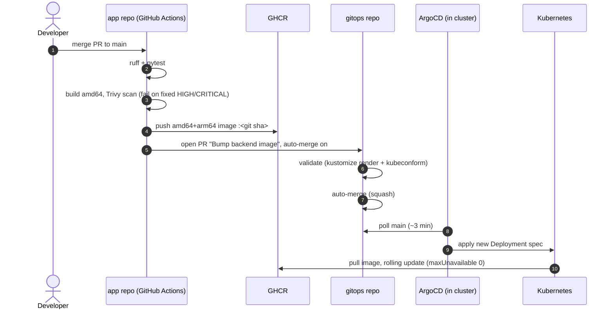
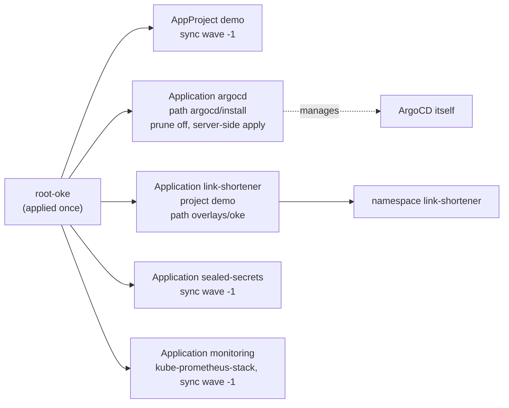
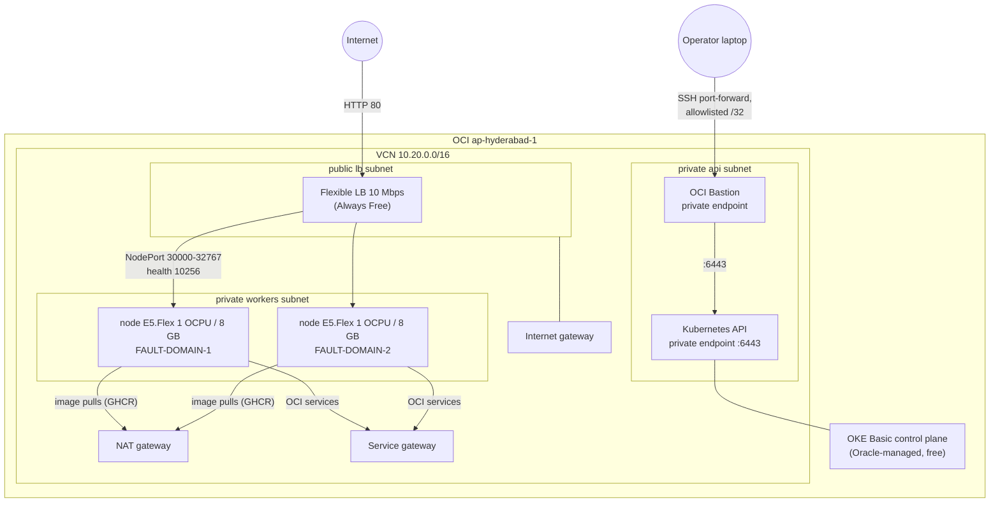
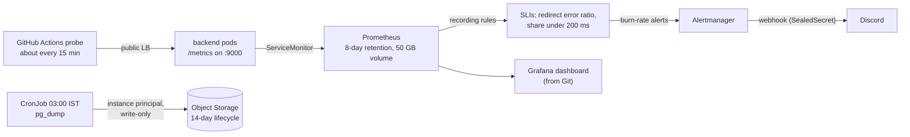
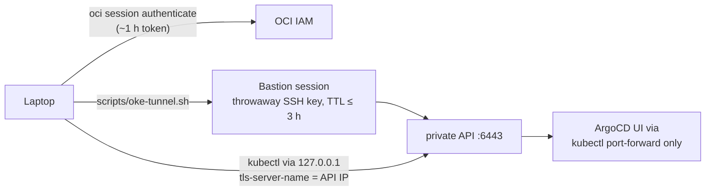
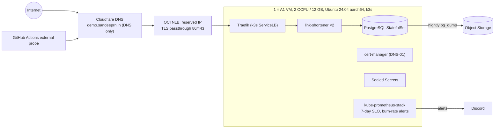

# Architecture

How the OCI Kubernetes GitOps demo is built, what runs today, and why it is
shaped this way. Decisions link to their ADRs in [`docs/adr/`](adr/).

> **As of 2026-10-25.** On the short-lived **OKE target**, the delivery
> pipeline, the link shortener on PostgreSQL, observability (SLO alerts proven
> with a live outage), and nightly backups (restore tested) are built and
> verified end to end. The long-lived **k3s node** on Always Free has its
> Terraform written (`terraform/k3s`) but is **not running yet**, because
> Ampere A1 capacity in the home region is unavailable. Sections marked
> *Planned* describe that design.

## 1. At a glance

| | Built and verified | Planned |
|---|---|---|
| **App** | FastAPI link shortener on PostgreSQL: 302 redirects, fail-fast 503s during a database outage, request metrics; non-root multi-arch image | Frontend |
| **CI** | Lint, test (with real Postgres), Trivy scan, amd64+arm64 build, push to GHCR, auto-merging tag-bump PR; gitleaks full-history scan in all three repos | — |
| **GitOps** | ArgoCD v3.5.6 app of apps, self-managed, Kustomize base and overlays, Sealed Secrets, `validate` check (kubeconform, Helm render, promtool, amtool) | k3s cluster root |
| **Clusters** | OKE target: 2 x86 nodes across fault domains, private API, public LB | k3s on one Always Free A1 node |
| **Edge** | OCI Flexible LB (10 Mbps, free) on the OKE target | NLB with reserved IP, Traefik, TLS at `demo.sandeeprn.in` |
| **Ops** | Remote Terraform state, Bastion access, budget alerts; Prometheus, Grafana, Alertmanager; redirect SLO with burn-rate alerts to Discord; external probe; nightly backups with a tested restore; runbooks; node-drain evidence | Clean-state rebuild on k3s |

## 2. Repositories

Three public repos, each with one job. Changes reach `main` only through pull
requests (ADR 0011).

| Repo | Holds | Changed by |
|---|---|---|
| [`oci-k8s-gitops-demo`](https://github.com/Sandeep-RN/oci-k8s-gitops-demo) | Terraform, scripts, ADRs, docs, issue tracker | Humans |
| [`oci-k8s-gitops-demo-app`](https://github.com/Sandeep-RN/oci-k8s-gitops-demo-app) | Backend code, Dockerfile, CI | Humans |
| [`oci-k8s-gitops-demo-gitops`](https://github.com/Sandeep-RN/oci-k8s-gitops-demo-gitops) | Kubernetes manifests, ArgoCD apps; the source of truth for every cluster | Humans, plus CI for image tags only |

## 3. Delivery pipeline (built)

A merge in the app repo reaches the cluster with no manual step and no
credentials to the cluster outside it. Verified on 2026-10-23: app commit
`8ec9f5be` was running on both OKE pods after one merge.



Key properties:

- **Scan before push.** A vulnerable image never reaches the registry. On its
  first run, Trivy blocked three HIGH CVEs in Starlette, which were fixed by
  upgrading.
- **Immutable tags.** Images are tagged with the git SHA; `latest` is never used.
- **Every deploy is a merged PR** in the gitops repo, so the deploy history is
  the PR history (ADR 0009).
- **Least privilege.** The bump job has no `GITHUB_TOKEN` permissions. It uses a
  fine-grained token limited to the gitops repo (contents and pull requests).
  Third-party Actions are pinned by commit SHA.
- **A guarded `main`.** The gitops repo's `main` requires a PR and the
  `validate` check, pinned to GitHub Actions. Auto-merge cannot bypass a broken
  manifest.

## 4. GitOps structure (built)

```
oci-k8s-gitops-demo-gitops/
  apps/link-shortener/
    base/                  Deployment, Service, PDB, Postgres StatefulSet, backup CronJob,
                           ServiceMonitor, SLO rules, dashboard; image tag set by CI
    overlays/k3s/          Always Free node (planned cluster)
    overlays/oke/          LoadBalancer Service, strict one-pod-per-node spread, oci-bv volume,
                           sealed Postgres credentials
  platform/sealed-secrets/ Sealed Secrets controller, pinned upstream release
  monitoring/              kube-prometheus-stack values, Grafana and Discord SealedSecrets
  tests/prometheus/        promtool unit tests for the alert rules
  argocd/
    install/               upstream ArgoCD v3.5.6, pinned, via Kustomize
    clusters/oke/
      root.yaml            the root "app of apps" (applied once by hand)
      apps/                AppProject "demo"; Applications argocd, sealed-secrets,
                           monitoring, link-shortener
```



- **Two manual commands per cluster, ever:** `kubectl apply --server-side -k
  argocd/install`, then `kubectl apply -f argocd/clusters/<cluster>/root.yaml`.
  After that, ArgoCD upgrades itself from Git.
- **The `demo` AppProject** limits workloads to this repo and the
  `link-shortener` namespace.
- **Overlays carry only real environment differences.** k3s will use Traefik
  Ingress and `local-path` storage. OKE uses an OCI LoadBalancer Service and
  strict spread.

## 5. OKE target (built, short-lived)

A second deploy target paid from the trial credit (ADR 0015). It proves that
the same GitOps repo runs on a managed, multi-node cluster. **It is torn down
by 2026-11-15** to keep the project at $0/month (issue #13).



Subnets: `api` 10.20.0.0/28 and `workers` 10.20.10.0/24 (private, no public IPs), `lb` 10.20.20.0/24 (public). One availability domain, three fault domains.

| Aspect | Choice | Why |
|---|---|---|
| Cluster type | **Basic** | Free control plane; Enhanced bills per hour and is the console default, so Terraform sets the type explicitly |
| Nodes | 2 × `VM.Standard.E5.Flex`, 1 OCPU / 8 GB | E4 and A1 had no host capacity; E6 has a service limit of 0. **A1 is blocked by a validation rule**, because A1 here would push the tenancy over the Always Free limit and get every A1 instance disabled |
| Placement | One node per fault domain | The region has one availability domain, so fault domains are the only placement spread available |
| CNI | Flannel overlay | Same model as k3s; no per-pod VCN IPs |
| API access | **Private endpoint only**, through OCI Bastion | No public 6443 (ADR 0010). Sessions are short-lived (max 3 h) and limited to one client /32 |
| Workers | Private subnet, no public IPs | Egress through NAT for GHCR; OCI services through the service gateway |
| LB rules | Pre-opened in Terraform; cloud controller set to security-list management `None` | Otherwise the controller edits the lists and Terraform drifts. Verified: no drift after LB creation |
| State | Own state key `oke/terraform.tfstate` | Destroying OKE can never touch the long-lived node |
| Pinning | Kubernetes `v1.36.4` and an exact node image name | A new Oracle image does not cause a plan diff; preconditions check that the image exists and matches |
| Tags | `lifecycle=ephemeral-oke`, `teardown_by=2026-11-15` | Teardown can be checked in Cost Analysis with one filter |

**Cost:** about USD 2 a day (two E5 nodes and boot volumes). The control plane,
LB, NAT, Bastion and VCN cost nothing. The trial credit is SGD 400, expiring
2026-11-19.

**Workload placement:** two backend replicas, `DoNotSchedule` spread on
hostname (one per node, so one per fault domain), PDB `minAvailable: 1`, and
rolling updates with `maxUnavailable: 0`. A node drain on this target kept the
service up (370 requests, 0 failures) and the PDB blocked eviction of the last
pod: [drain evidence](evidence/oke-drain-2026-10-24.md).

## 6. Observability and backups (built)



- **SLO (ADR 0008):** over 7 days, 99.5% of redirects are not 5xx, and 95% of
  the rest finish under 200 ms. Alerts are multi-window burn rates
  (14.4x and 6x page, 3x and 1x ticket), with a 20-request traffic floor. Rules
  are unit-tested with promtool in CI and were proven live: a 5-minute
  database outage fired the fast alert to Discord and resolved it
  ([runbook](runbooks/slo-redirect-availability.md)).
- **Readiness stays pod-local (ADR 0016):** a database outage keeps pods in the
  Service answering fast 503s, so every failure is counted by the SLI.
- **External probe:** a scheduled GitHub Actions job requests a known short
  link from outside the cluster. That covers what in-cluster metrics cannot:
  quiet periods with no traffic, and requests that never reach the app.
- **Backups (ADR 0007, 0017):** nightly `pg_dump` uploaded by the OCI CLI with
  instance-principal auth. The nodes may only create and list objects in the
  bucket; read, overwrite and delete were verified to be denied. Restores use
  the operator's login; a drill restored identical data
  ([runbook](runbooks/postgres-backup-restore.md)). `PostgresBackupMissing`
  alerts after 26 h without a success.
- **Admin UIs** (ArgoCD, Grafana, Prometheus, Alertmanager) are reachable only
  by port-forward ([access runbook](runbooks/access.md)).

## 7. Access model



- **No long-lived cloud keys on disk.** Terraform and the CLI use OCI session
  tokens (`auth = "SecurityToken"`).
- **The tunnel script** creates a throwaway SSH key and session, writes the
  kubeconfig outside the repo, and deletes the session on Ctrl+C.
- **Admin UIs** (ArgoCD, Grafana, Prometheus, Alertmanager) are reachable
  only by port-forward, never exposed (ADR 0014).
- Step-by-step commands: [access runbook](runbooks/access.md).

## 8. Infrastructure as code

```
oci-k8s-gitops-demo/
  scripts/bootstrap-state.sh   one-time: compartment + versioned private state bucket (idempotent)
  scripts/oke-tunnel.sh        kubectl access to the private OKE API
  terraform/backend.hcl        generated, git-ignored
  scripts/a1-wait-and-apply.sh retries the k3s apply until A1 capacity appears
  terraform/oke/               OKE target: VCN, gateways, subnets, security lists, cluster, node pool, Bastion
  terraform/shared/            backup bucket, lifecycle rule, write-only IAM (outlives any cluster)
  terraform/k3s/               k3s node and network (written; waiting for A1 capacity); NLB, reserved IP, DNS later
```

- **State:** the native `oci` backend, in a versioned Object Storage bucket,
  with locking (ADR 0003).
- **Proven re-runnable:** `terraform plan` shows no changes after apply, after
  the LB was created, and on `main`.
- **Guardrails:** `terraform fmt`, `terraform validate` and gitleaks (with
  custom OCI rules) run as pre-commit hooks; gitleaks also scans the full
  history in CI in all three repos, because `--no-verify` skips hooks.

## 9. Security summary

| Area | Control |
|---|---|
| Secrets in Git | gitleaks with OCI rules, as a pre-commit hook and as a full-history CI job in every repo. tfvars, state, backend.hcl and kubeconfig are git-ignored. Outputs holding OCIDs or IPs are marked sensitive. Only SealedSecrets may be committed, and CI rejects plain `Secret` manifests |
| Supply chain | Actions pinned by SHA; checksum-verified tool downloads; Trivy gate before push; pinned dependency versions |
| Runtime | Non-root UID 10001, read-only root filesystem, all capabilities dropped, seccomp `RuntimeDefault`, no service-account token mounted |
| Database | The backend uses its own non-superuser role that owns only its table; the superuser is kept for the server, backups and the role-setup Job (ADR 0018) |
| Network | Private workers and API; Bastion allowlisted to one /32; public exposure only through the LB on 80/443 |
| Cloud auth | Short-lived session tokens; a dedicated compartment. In-cluster access to OCI is node identity with a write-only policy on one bucket (ADR 0017) |
| Cost | Budget with 50% and 100% actual-spend alerts; an A1 guardrail in Terraform; teardown date tagged on every resource |

## 10. Planned: the long-lived Always Free target

The design the live demo will run on (ADR 0001, 0002, 0004, 0005, 0006, 0007,
0008, 0012, 0013). It is blocked on A1 capacity.



There is no node-level high availability: a single node cannot honour a PDB
during a drain. The README will say so plainly. The OKE target demonstrates the
multi-node behaviour instead ([drain evidence](evidence/oke-drain-2026-10-24.md)).

## 11. Decision index

| ADR | Decision |
|---|---|
| [0001](adr/0001-single-node-k3s-on-always-free-a1.md) | Single-node k3s on one Always Free A1 instance |
| [0002](adr/0002-ubuntu-2404-aarch64-node-os.md) | Ubuntu 24.04 (aarch64) as the node OS |
| [0003](adr/0003-terraform-state-in-object-storage.md) | Terraform state in Object Storage (native `oci` backend) |
| [0004](adr/0004-nlb-tls-passthrough-to-traefik.md) | NLB with TLS passthrough to Traefik |
| [0005](adr/0005-cert-manager-cloudflare-dns01.md) | cert-manager with Cloudflare DNS-01 |
| [0006](adr/0006-sealed-secrets.md) | Sealed Secrets for secrets in Git |
| [0007](adr/0007-postgres-statefulset-with-dump-backups.md) | PostgreSQL StatefulSet with nightly dump backups |
| [0008](adr/0008-observability-and-slo.md) | kube-prometheus-stack and a redirect SLO |
| [0009](adr/0009-ci-commits-image-tag-to-gitops-repo.md) | CI opens an auto-merging tag-bump PR |
| [0010](adr/0010-node-access-ssh-tunnel.md) | No public Kubernetes API |
| [0011](adr/0011-workflow-and-scope.md) | PR workflow; core vs stretch scope |
| [0012](adr/0012-node-firewall-and-cloud-init.md) | Node firewall handled in cloud-init |
| [0013](adr/0013-dns-and-reserved-ip.md) | Reserved public IP and Terraform-managed DNS |
| [0014](adr/0014-admin-ui-access.md) | Admin UIs only through port-forward |
| [0015](adr/0015-oke-ephemeral-second-target.md) | OKE as a short-lived second deploy target |
| [0016](adr/0016-readiness-checks-pod-local-state-only.md) | Readiness checks pod-local state only, not the shared database |
| [0017](adr/0017-backup-auth-instance-principals-write-only.md) | Backups use instance principals with a write-only policy |
| [0018](adr/0018-app-database-role-least-privilege.md) | The backend connects with its own non-superuser database role |
