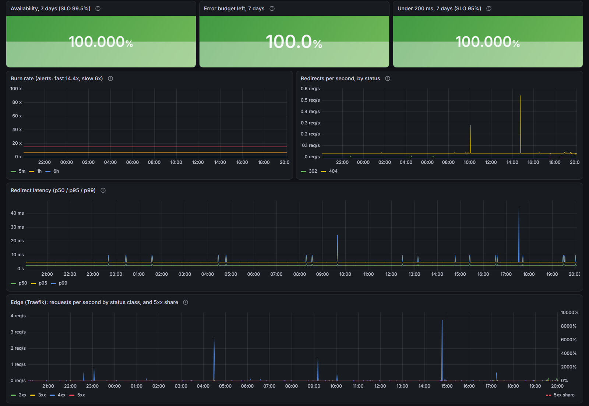
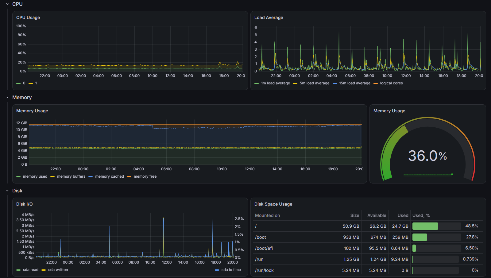
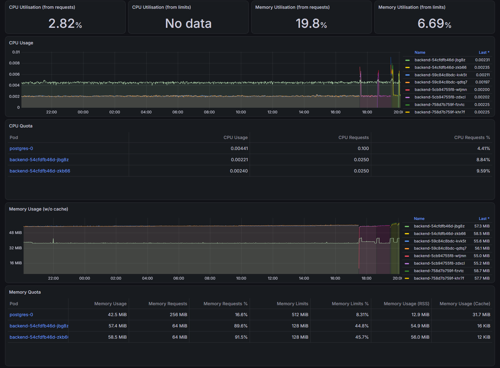

# Grafana dashboards on the live k3s node, 2026-11-24

Issue: #236. Grafana is private (ADR 0014: no admin UI gets a public Ingress; it is reached by `kubectl port-forward` over the SSH tunnel, ADR 0010). These are screenshots of the real dashboards, captured on 2026-11-24 at about 20:00 UTC, so a viewer can see what the tool looks like without a login. The public, live equivalent is the [Platform metrics](https://demo.sandeeprn.in/status) page (ADR 0026, ADR 0027), drawn from the same Prometheus.

All three show the last 24 hours in UTC. The cluster's Prometheus holds about 4 days of data at the time of capture (it keeps 8), so nothing here goes back further.

## 1. Link shortener / Redirect SLO (our own dashboard)

Availability, error budget and the share of redirects under 200 ms, each over 7 days (all at 100% because nothing failed); the burn rate against the alert thresholds (14.4x fast, 6x slow, ADR 0008); redirects per second by status (302 and 404; the 404s are the in-cluster probe's unknown code, ADR 0019); redirect latency p50, p95 and p99; and the edge view from Traefik. Source: `apps/link-shortener/base` in the gitops repo.

## 2. Node Exporter / Nodes (the one node)

CPU mostly between 10% and 20%, load average with a regular pattern of short spikes (about 18 in the 24 hours; the cause was not investigated, so none is claimed here), memory 36% used of about 12 GiB, disk I/O, and disk space (root volume 48.5% used). One VM, 2 OCPU and 12 GB, runs everything (ADR 0001, ADR 0025).

## 3. Kubernetes / Compute Resources / Namespace (Pods), namespace `link-shortener`

CPU and memory per pod against requests and limits. Each backend pod uses about 55 to 59 MiB against a 64 MiB request and a 128 MiB limit; Postgres uses 42 MiB of a 256 MiB request. "CPU utilisation from limits" reads "No data" on purpose: the pods set a CPU request and a memory limit, and no CPU limit. The older pod names are the previous Deployments' pods during the day's rollouts.

## How these were captured, and what was left out
- Real data only; nothing edited. A headless Chrome (through its debugging port) loaded each dashboard in kiosk mode with a Grafana session; the login was done in a script and the password was never printed or written anywhere.
- The top bar of each dashboard (the data source, the time picker and, on the node dashboard, the node's private network address) was cropped away before saving. Every image was looked at before it was committed: no addresses, node names, user names or organisation names.
- Not shown: Argo CD (no dashboard; only `argocd_app_info` is scraped, see ADR 0026) and the node dashboard's network panels (a long list of per-pod virtual interfaces).
- The images are a snapshot of one day. For current numbers use the Platform metrics page.
